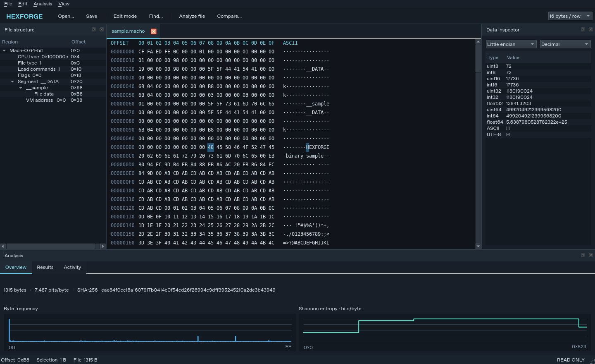

# HEXFORGE

C++20과 Qt 6 Widgets로 만든 로컬 바이너리 편집기입니다. 원본은 읽기 전용으로 열립니다. HEX와 ASCII 열에서 같은 위치를 선택하고, 파일 구조 트리나 검색 결과에서 해당 바이트로 이동할 수 있습니다.



## macOS에서 빌드하고 실행하기

Xcode Command Line Tools와 Homebrew가 필요합니다. 개발 도구가 없는 Mac에서는 먼저 `xcode-select --install`을 실행합니다. 저장소 루트에서 다음 명령을 실행하세요.

```bash
brew install qt cmake ninja
./scripts/package-macos.sh
open build-macos/HEXFORGE.app
```

스크립트는 Release 빌드, CTest, Qt 프레임워크와 플랫폼 플러그인 배치, 로컬 실행용 ad hoc 코드 서명 검증을 순서대로 수행합니다. 결과는 `build-macos/HEXFORGE.app`과 배포용 압축 파일 `build-macos/HEXFORGE-macOS.zip`입니다. Developer ID 서명 및 Apple 공증은 별도의 배포 단계입니다.

Apple Silicon은 기본적으로 arm64, Intel Mac은 x86_64를 빌드합니다. 두 아키텍처를 포함하는 Qt SDK를 설치한 경우 아래처럼 Universal 앱을 빌드할 수 있습니다. Qt 버전에 맞는 macOS SDK와 배포 대상 버전이 필요합니다.

```bash
QT_PREFIX=/path/to/universal/Qt ARCHS='arm64;x86_64' BUILD_DIR=build-universal ./scripts/package-macos.sh
```

GitHub Actions의 **macOS bundle** 작업도 macOS에서 같은 스크립트를 실행하고 성공한 빌드의 ZIP을 아티팩트로 보관합니다.

## 첫 편집

1. **Open**으로 `examples/sample.macho`를 엽니다. 실행 코드가 없는 arm64 Mach-O 오브젝트로, ASCII·UTF-8 문자열, 반복 바이트, 0부터 255까지의 값이 들어 있습니다.
2. 왼쪽에서 **Segment __DATA → __sample → File data**를 펼치고 항목을 두 번 클릭하세요. 파일 데이터는 `0xB8`에서 시작하며 오른쪽 Inspector에서 첫 글자 `H`와 정숫값 `72`를 확인할 수 있습니다.
3. **Edit mode**를 켜고 HEX 열의 `48` 한 바이트를 클릭한 뒤 `4A`를 입력하세요. ASCII 열에는 `J`가 표시됩니다. 수정한 바이트는 호박색, 현재 선택은 파란색, 비교 차이는 분홍색입니다.
4. **File → Save as**로 복사본을 저장하세요. **Save**는 현재 경로에 저장합니다. 저장이 성공하면 다시 읽기 전용으로 열립니다.
5. **Compare**로 원래 예제를 선택하면 차이의 시작 주소와 길이가 표시됩니다. 결과를 두 번 클릭하면 편집기가 해당 범위를 선택합니다.

## 조작

| 작업 | 동작 |
|---|---|
| 열기 / 저장 / 다른 이름으로 저장 | ⌘O / ⌘S / ⇧⌘S |
| 편집 모드 전환 | ⌘E |
| HEX / 텍스트 입력 | 입력할 열 클릭. HEX는 두 자리씩, 텍스트 입력은 UTF-8로 기록 |
| 선택 / 범위 확장 | 드래그 또는 Shift와 방향키 |
| 삽입 / 덮어쓰기 | Edit → Insert mode. 기본은 덮어쓰기이며 EOF에서는 추가 |
| 삭제 / 복사 / 붙여넣기 | Delete 또는 Backspace / ⌘C / ⌘V |
| 실행 취소 / 다시 실행 | ⌘Z / ⇧⌘Z |
| 검색 / 오프셋 이동 | ⌘F / ⌘G. 오프셋은 10진수 또는 `0x`로 시작하는 16진수 |
| 선택 영역 추출 | File → Extract selection |
| 비교 내보내기 | File → Export differences. 표시한 차이 구간을 CSV로 저장 |
| 패널 복원 | View에서 닫힌 패널을 다시 표시 |

파일을 창으로 드롭하거나 명령행 인수로 여러 경로를 열 수 있습니다. 레이아웃, 해석 진법, 바이트 순서, 행 너비, 최근 파일 12개와 최근 작업 기록 100개를 QSettings에 저장합니다. 클립보드 복사는 선택당 16 MiB까지 지원하며 더 큰 범위는 파일로 추출할 수 있습니다.

## 분석 기능과 해석 범위

- **Inspector**는 커서부터 최대 8바이트를 읽어 8/16/32/64비트 부호 있는 정수와 없는 정수, IEEE 부동소수점, ASCII 문자와 첫 UTF-8 코드 포인트를 표시합니다. 정수 진법과 바이트 순서를 전환할 수 있습니다. 범위 부족, 잘린 UTF-8, 잘못된 인코딩을 구분합니다.
- **구조 트리**는 Mach-O의 32/64비트 헤더, CPU, 플래그, 로드 명령, 세그먼트, 섹션과 파일 데이터 범위를 표시합니다. Universal 파일은 각 슬라이스의 바이트 순서와 내부 오프셋을 따로 처리합니다. ELF는 섹션 테이블, PE는 COFF와 섹션 테이블, PNG는 청크와 이미지 크기, JPEG는 첫 스캔 전 마커와 프레임 크기, ZIP은 로컬 엔트리를 탐색합니다. JPEG 압축 스캔과 ZIP 데이터 디스크립터 뒤의 데이터는 디코딩하지 않습니다. 인식할 수 없는 내용은 Unknown으로 표시합니다.
- **Analyze file / Analyze selection**은 범위 크기, SHA-256, 바이트 빈도, 전체 Shannon 엔트로피 및 최대 256개 순차 구간의 엔트로피를 계산합니다. 그래프에 마우스를 올리면 위치 또는 빈도를 확인할 수 있습니다. 엔트로피는 0~8 bits/byte이며 높은 값은 압축 데이터나 난수 등에서도 나타납니다.
- **검색과 문자열 추출**은 블록 경계를 넘는 패턴도 처리합니다. 문자열은 출력 가능한 ASCII 및 유효한 UTF-8 문자 네 개 이상을 추출합니다. 긴 문자열의 미리보기는 120자로 제한하며 결과 범위에는 전체 길이를 기록합니다.
- **반복 패턴**은 1~8바이트 단위가 네 번 이상 연속되는 구간을 찾습니다. **비교**는 같은 오프셋에서 다른 바이트와 길이가 다른 꼬리 영역을 묶어서 표시합니다. 삽입으로 밀려난 구간은 이후 오프셋에서 계속 차이로 표시될 수 있습니다.
- 검색·문자열·반복·비교 결과의 표시 상한은 작업당 4,096개입니다. 상한에 도달해 결과가 생략되면 상태 표시줄과 작업 기록에서 알려줍니다. 비교 CSV에도 표시된 구간만 포함합니다.
- **Binary template**은 실행 코드가 없는 JSON 필드 목록입니다. Analysis → Load binary template에서 `examples/sample.template.json`을 열어 구조 트리에 이름 붙은 범위를 추가하세요. 필드의 `offset`과 `length`는 파일 시작 기준 바이트 단위입니다.

## 파일 처리와 구현 구조

| 소스 | 역할 |
|---|---|
| `src/document.*` | 읽기 전용 파일 핸들, 원본 범위와 편집 바이트를 조합하는 piece table, Undo/Redo, 안전 저장 |
| `src/editor.*` | 화면에 보이는 행만 그리는 Qt 위젯, 64비트 오프셋, 선택과 입력 |
| `src/formats.*` | 바이트 해석, 경계 검사를 포함한 형식별 파싱, 선언형 템플릿 |
| `src/analysis.*` | 64 KiB 단위 검색·비교·통계, 취소 가능한 분석 |
| `src/window.*` | 탭과 도킹 패널, 그래프, 파일 대화상자, 백그라운드 작업 연결 |

편집 시 원본 파일 전체를 RAM에 올리지 않습니다. 수정 바이트와 편집 구간 목록, 최대 256단계의 실행 취소 기록은 메모리에 유지합니다. 큰 붙여넣기나 매우 많은 조각으로 나뉜 편집은 추가 메모리를 사용합니다. 분석은 QtConcurrent에서 편집 상태의 스냅샷을 사용합니다. 탭이나 편집 내용이 바뀌면 이전 결과를 폐기합니다. 외부 바이너리를 실행하거나 압축을 풀지 않습니다.

저장·추출은 같은 디렉터리에 임시 파일을 만들고 1 MiB 단위로 기록한 뒤 QSaveFile로 교체합니다. 임시 파일을 만들 수 없는 경우 원본에 직접 쓰는 대체 경로를 차단합니다. 쓰기 시작 전과 커밋 직전에 원본의 장치, inode, 크기, 수정 시각을 확인합니다. 출력 크기만큼 여유 디스크가 필요합니다. 저장과 추출 중에는 GUI가 기다릴 수 있으며, 다른 프로그램과 동시에 같은 파일을 수정하는 용도의 잠금 기능은 제공하지 않습니다.

## 개발 빌드와 테스트

Qt 6.4 이상, C++20 컴파일러, CMake 3.21 이상이 필요합니다. macOS 이외에는 Linux에서도 개발 빌드와 GUI 테스트를 실행할 수 있습니다. Debian 계열의 의존성은 `g++ cmake ninja-build qt6-base-dev qt6-qpa-plugins`입니다.

```bash
cmake -S . -B build -G Ninja -DCMAKE_BUILD_TYPE=Release
cmake --build build
ctest --test-dir build --output-on-failure
```

macOS에서 Qt를 자동 탐색하지 못하면 구성 명령에 `-DCMAKE_PREFIX_PATH="$(brew --prefix qt)"`를 추가하세요. Linux에서 예제를 열려면 `./build/HEXFORGE examples/sample.macho`를 실행합니다.

테스트는 임시 디렉터리를 사용합니다. 편집·원본 보존, 5 GiB 희소 파일의 끝부분 읽기, 블록 경계 검색, UTF-8과 잘린 헤더, Mach-O Universal 슬라이스의 섹션 오프셋, 비교·엔트로피·반복 패턴을 검사합니다. GUI 테스트는 Qt의 offscreen 플랫폼에서 창을 열고 키 입력, Undo/Redo, 저장, 백그라운드 분석 결과 표시까지 확인합니다. 위 화면은 Linux의 Qt Widgets 실행 결과입니다.
